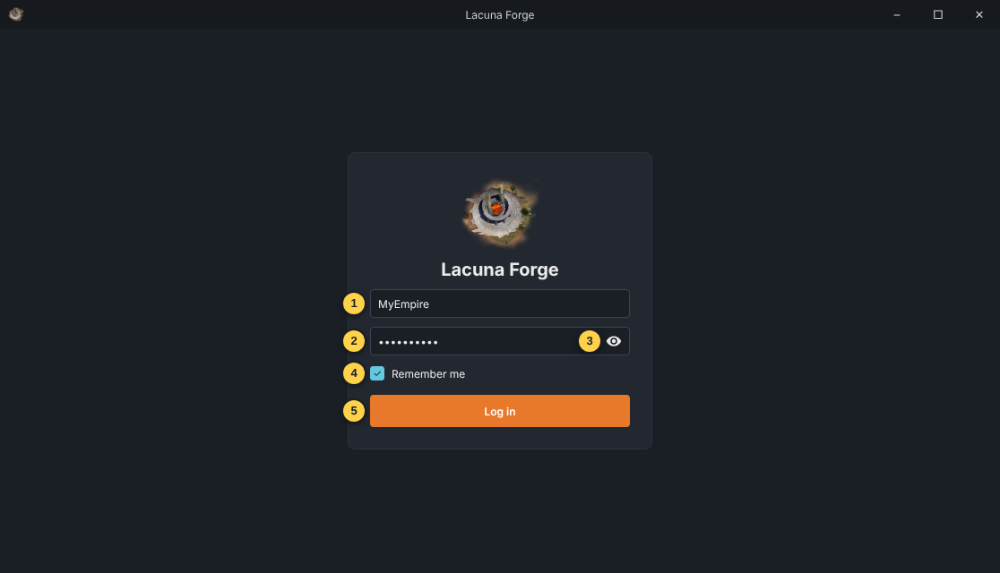
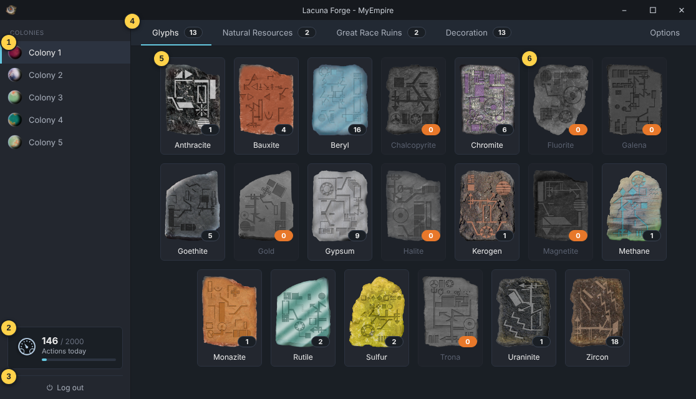
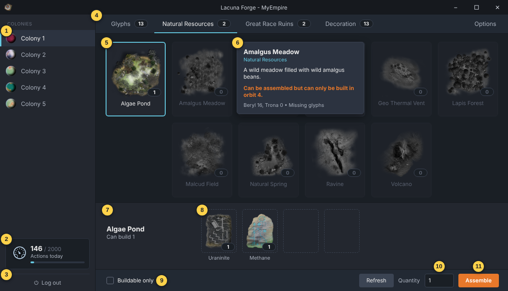
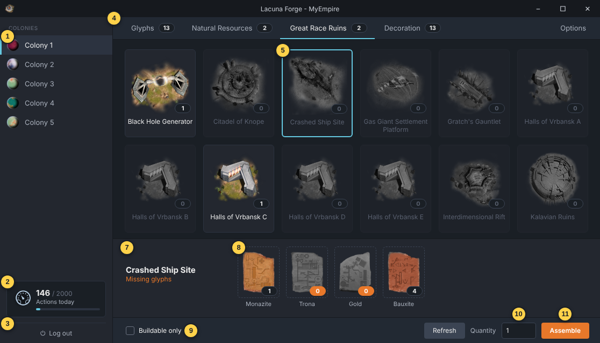
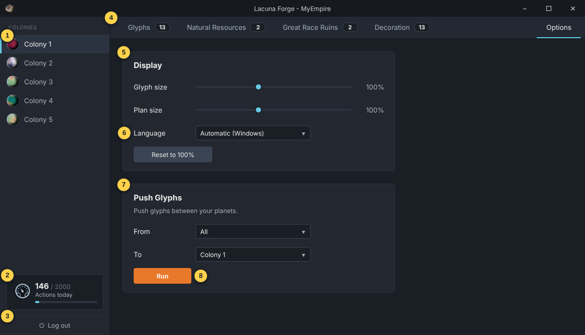
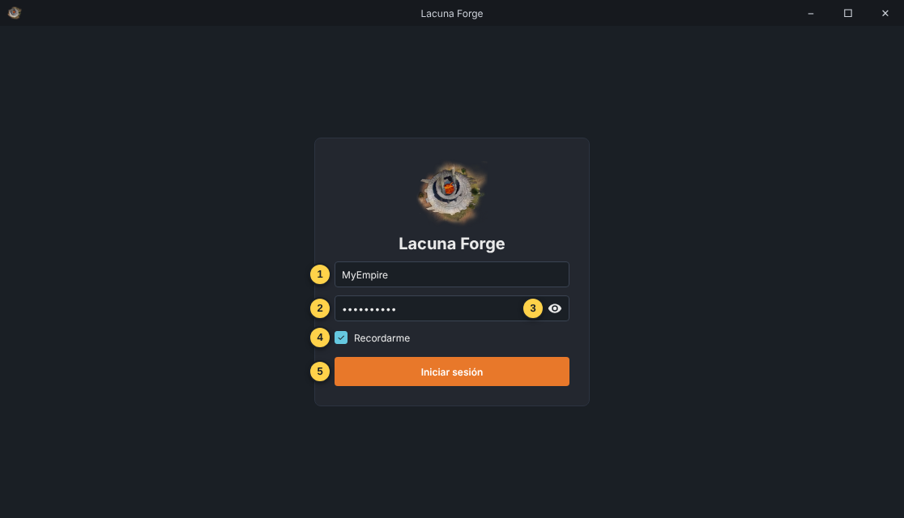
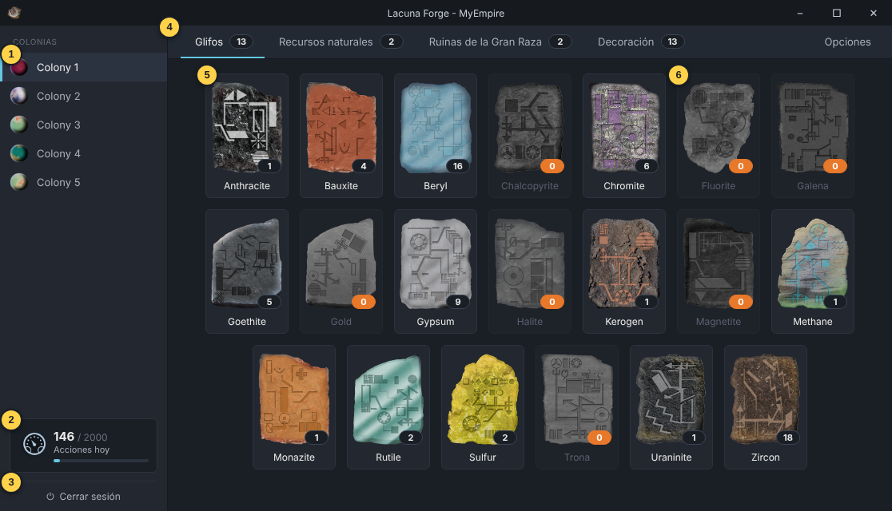
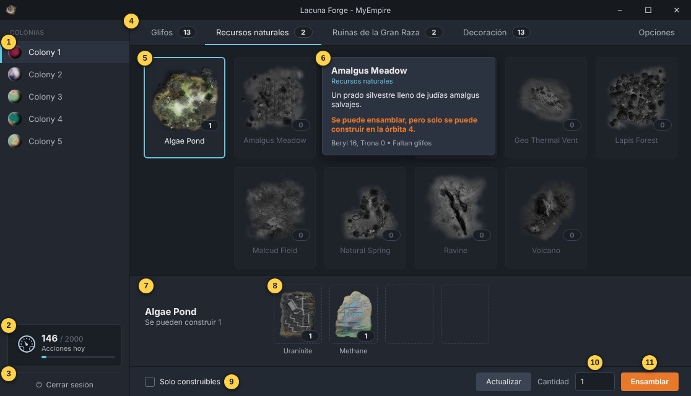
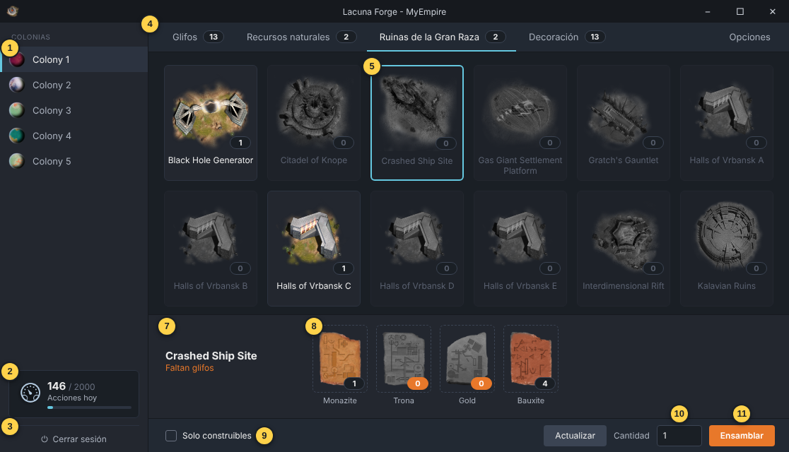
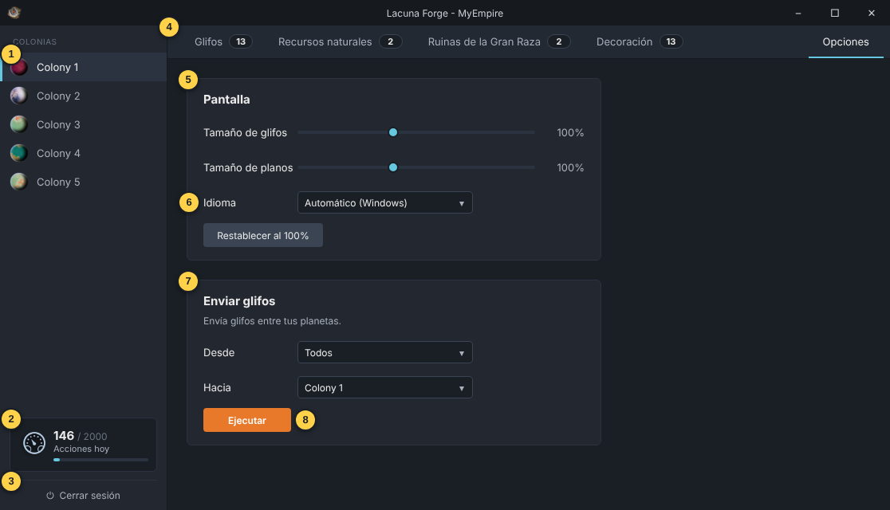

# Lacuna Forge

A forge for creating TLE Community glyph buildings.

**[English](#english)** · **[Español](#español)**

---

## English

Lacuna Forge is a Windows app for **The Lacuna Expanse** community server
(`meanjin-one.tlecommunity.com`). It shows the glyphs on each of your planets,
which glyph buildings (plans) you can make from them, and assembles them for you.
It can also push glyphs between your planets.

It is one standalone `.exe`: no runtime packages or extra DLLs. The game artwork,
the dark style and the Spanish translation are all built in.

### Installing

Run `LacunaForgeSetup-<version>.exe`. It installs for your Windows user only and
needs no administrator rights. It adds a Start menu shortcut, and optionally a
desktop icon. The installer uninstalls cleanly from *Settings → Apps*.

The app picks English or Spanish from your Windows display language. You can
change it on the **Options** tab.

### Log in

1. **Empire**: your empire name on the server.
2. **Password**: your empire password.
3. **Eye**: shows the password so you can check it. Click again to hide it.
4. **Remember me**: remembers the password for next time. It is stored
   encrypted with Windows (DPAPI), so only your Windows account on this PC can
   read it. Untick it to forget the password straight away.
5. **Log in**: enabled once both fields are filled. Nothing else in the app can
   be used until the server accepts your login.

### Glyphs

1. **Colonies**: your planets, each with its planet type's picture. Click one
   to load its glyphs.
2. **Actions today**: the server's count of your requests today, out of the
   daily limit. The bar fills as you use them.
3. **Log out**: ends the session and returns to the login page.
4. **Tabs**: each badge counts what is ready. On **Glyphs**, the number of glyph
   types you hold; on the plan tabs, how many plans you can build now. A badge
   turns orange at 0.
5. **Glyph tile**: the glyph and how many this planet holds.
6. **None held**: greyed out, with an orange count.

### Plans: Natural Resources, Great Race Ruins and Decoration

The plans are split across three tabs, sorted using the game's own building
descriptions.

**1–4**: as on the Glyphs tab.

5. **Selected plan**: click a plan to select it. The badge shows how many you
   can assemble from this planet's glyphs.
6. **Info box**: hover over any plan to see its name, its category, the game's
   description of the building, and its recipe with your stock. Buildings tied to
   certain orbits say so in orange, for example *"Can be assembled but can only
   be built in orbit 4."*
7. **Plan and status**: the selected plan and how many you can build, or
   *Missing glyphs*.
8. **Recipe**: the glyphs in the order the game combines them, each with your
   stock.
9. **Buildable only**: when ticked, only plans you can make now are shown. Untick
   it to see everything, including what you are missing.
10. **Quantity**: how many to assemble, up to what you can build (50 at most).
11. **Assemble**: asks you to confirm, then makes the plans on this planet.
   The glyphs are used up, and this cannot be undone.

With **Buildable only** unticked (9), a plan you cannot make yet (5) shows
*Missing glyphs* (7). The glyphs you are short of are greyed out with an orange
count (8).

### Options

**1–4**: as on the Glyphs tab.

5. **Display**: the size of the glyph and plan tiles, from 60% to 160%. The sizes
   are remembered.
6. **Language**: Automatic (Windows), English or Español.
7. **Push Glyphs**: sends glyphs from one planet, or **All**, to another of your
   planets by cargo ship. Each sending planet needs a Trade Ministry and a free
   cargo ship.
8. **Run**: first checks every planet and lists what would be sent, on which
   ship, and anything left behind. **Nothing moves until you confirm.** Then it
   sends, and shows when each ship arrives.

### Good to know

- **Server calls are logged** to `LacunaForge.log` beside the app: every request
  it makes, with your password masked. If anything ever changes in your empire
  unexpectedly, the log shows whether the app did it.
- **Settings** are kept in `LacunaForge.ini` beside the app. Uninstalling removes
  both files.
- **Correcting the Spanish:** put an edited `es.lang` beside the app. It
  overrides the built-in text, so no rebuild is needed.
- If you see *"Server did not return JSON"*, the game server is usually down for
  a while. Try again later.

### Credits

Glyph, building and planet artwork is from The Lacuna Expanse, via the TLE
community's assets repository. The interface style is from
[Freestyler](https://github.com/GrooverMD/Freestyler). Lacuna Forge by Mark S Day.

---

## Español

Lacuna Forge es una aplicación de Windows para el servidor comunitario de
**The Lacuna Expanse** (`meanjin-one.tlecommunity.com`). Muestra los glifos de
cada uno de tus planetas, qué edificios de glifos (planos) puedes hacer con ellos,
y los ensambla por ti. También puede enviar glifos entre tus planetas.

Es un único `.exe` independiente, sin paquetes de ejecución ni DLL adicionales.
El arte del juego, el estilo oscuro y la traducción al español van incluidos.

### Instalación

Ejecuta `LacunaForgeSetup-<versión>.exe`. Se instala solo para tu usuario de
Windows y no necesita permisos de administrador. Añade un acceso directo en el
menú Inicio y, si quieres, un icono en el escritorio. Se desinstala sin dejar
rastro desde *Configuración → Aplicaciones*.

La aplicación elige inglés o español según el idioma de Windows. Puedes cambiarlo
en la pestaña **Opciones**.

### Iniciar sesión

1. **Imperio**: el nombre de tu imperio en el servidor.
2. **Contraseña**: la contraseña de tu imperio.
3. **Ojo**: muestra la contraseña para comprobarla. Vuelve a hacer clic para
   ocultarla.
4. **Recordarme**: recuerda la contraseña para la próxima vez. Se guarda cifrada
   con Windows (DPAPI), así que solo tu cuenta de Windows en este PC puede leerla.
   Desmárcalo para olvidarla al instante.
5. **Iniciar sesión**: se activa cuando ambos campos están completos. El resto de
   la aplicación no se puede usar hasta que el servidor acepta el inicio de sesión.

### Glifos

1. **Colonias**: tus planetas, cada uno con la imagen de su tipo de planeta. Haz
   clic en uno para cargar sus glifos.
2. **Acciones hoy**: el recuento del servidor de tus peticiones de hoy, sobre el
   límite diario. La barra se llena a medida que las usas.
3. **Cerrar sesión**: termina la sesión y vuelve a la página de inicio.
4. **Pestañas**: cada distintivo cuenta lo que está listo. En **Glifos**, los
   tipos de glifo que tienes; en las pestañas de planos, cuántos planos puedes
   construir ahora. El distintivo se vuelve naranja en 0.
5. **Glifo**: el glifo y cuántos tiene este planeta.
6. **Ninguno**: en gris, con el número en naranja.

### Planos: Recursos naturales, Ruinas de la Gran Raza y Decoración

Los planos se reparten en tres pestañas, según las propias descripciones de los
edificios del juego.

**1–4**: igual que en la pestaña Glifos.

5. **Plano seleccionado**: haz clic en un plano para seleccionarlo. El distintivo
   muestra cuántos puedes ensamblar con los glifos de este planeta.
6. **Cuadro de información**: pasa el ratón sobre cualquier plano para ver su
   nombre, su categoría, la descripción del edificio en el juego y su receta con
   tus existencias. Los edificios limitados a ciertas órbitas lo indican en
   naranja, por ejemplo *"Se puede ensamblar, pero solo se puede construir en la
   órbita 4."*
7. **Plano y estado**: el plano seleccionado y cuántos puedes construir, o
   *Faltan glifos*.
8. **Receta**: los glifos en el orden en que el juego los combina, cada uno con
   tus existencias.
9. **Solo construibles**: si está marcado, solo se muestran los planos que puedes
   hacer ahora. Desmárcalo para verlos todos, incluido lo que te falta.
10. **Cantidad**: cuántos ensamblar, hasta lo que puedes construir (50 como
    máximo).
11. **Ensamblar**: pide confirmación y luego crea los planos en este planeta.
    Los glifos se gastan y no se puede deshacer.

Con **Solo construibles** desmarcado (9), un plano que aún no puedes hacer (5)
muestra *Faltan glifos* (7). Los glifos que te faltan aparecen en gris con el
número en naranja (8).

### Opciones

**1–4**: igual que en la pestaña Glifos.

5. **Pantalla**: el tamaño de los glifos y los planos, del 60% al 160%. Los
   tamaños se recuerdan.
6. **Idioma**: Automático (Windows), English o Español.
7. **Enviar glifos**: envía glifos desde un planeta, o desde **Todos**, a otro de
   tus planetas en nave de carga. Cada planeta que envía necesita un Ministerio de
   Comercio y una nave de carga libre.
8. **Ejecutar**: primero comprueba cada planeta y muestra qué se enviaría, en qué
   nave y lo que se queda. **Nada se mueve hasta que confirmas.** Después lo envía
   y muestra cuándo llega cada nave.

### Conviene saber

- **Las llamadas al servidor se registran** en `LacunaForge.log`, junto a la
  aplicación: cada petición que hace, con la contraseña oculta. Si algo cambia
  en tu imperio sin esperarlo, el registro muestra si fue la aplicación.
- **La configuración** se guarda en `LacunaForge.ini`, junto a la aplicación. Al
  desinstalar se borran ambos archivos.
- **Para corregir el español:** coloca un `es.lang` editado junto a la aplicación.
  Sustituye al texto incluido, sin necesidad de recompilar.
- Si ves *"Server did not return JSON"*, normalmente el servidor del juego está
  caído un rato. Inténtalo más tarde.

### Créditos

El arte de los glifos, edificios y planetas es de The Lacuna Expanse, a través del
repositorio de recursos de la comunidad TLE. El estilo de la interfaz es de
[Freestyler](https://github.com/GrooverMD/Freestyler). Lacuna Forge, de Mark S Day.
